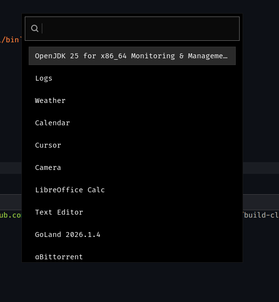

# installation

```bash 
meson setup build 
meson configure build -Dbuildtype=release -Dprefix=~/.local
meson install -C build
```

This will install binary in `~/.local/bin`

# uninstallation

```bash
cd ~/.local/bin
rm vapplauncher
```

# how it looks



# deps 
- gtkmm (gtk4)
- gtk4-layer-shell
- rapidfuzz-cpp

# note
Installation requires deps
