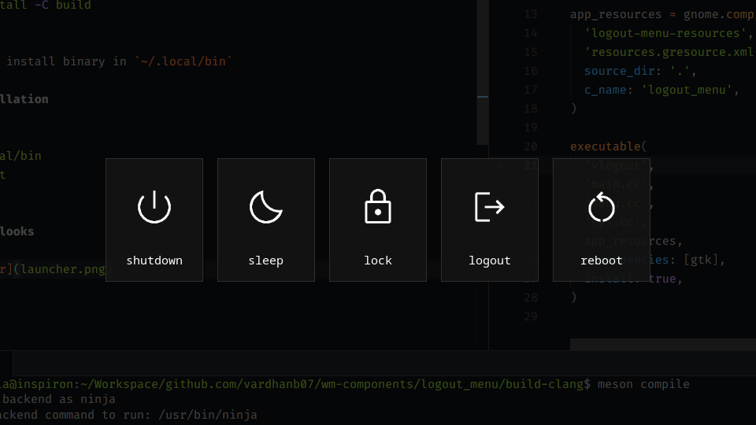

# installation

```bash
meson setup build
meson configure build -Dbuildtype=release -Dprefix=~/.local
meson install -C build
```

This will install binary in `~/.local/bin`

# uninstallation

```bash
cd ~/.local/bin
rm vlogout
```

# how it looks



# example config

```json
{
  "shutdown": {
    "cmd": ""
  },
  "sleep": {
    "cmd": ""
  },
  "reboot": {
    "cmd": ""
  },
  "logout": {
    "cmd": ""
  },
  "lock": {
    "cmd": ""
  }
}
```

# deps

- gtkmm(gtk4)
- gtk4-layer-shell

# note

Installation requires deps
